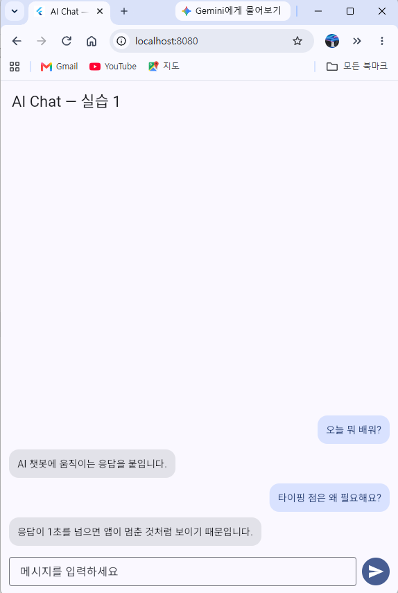
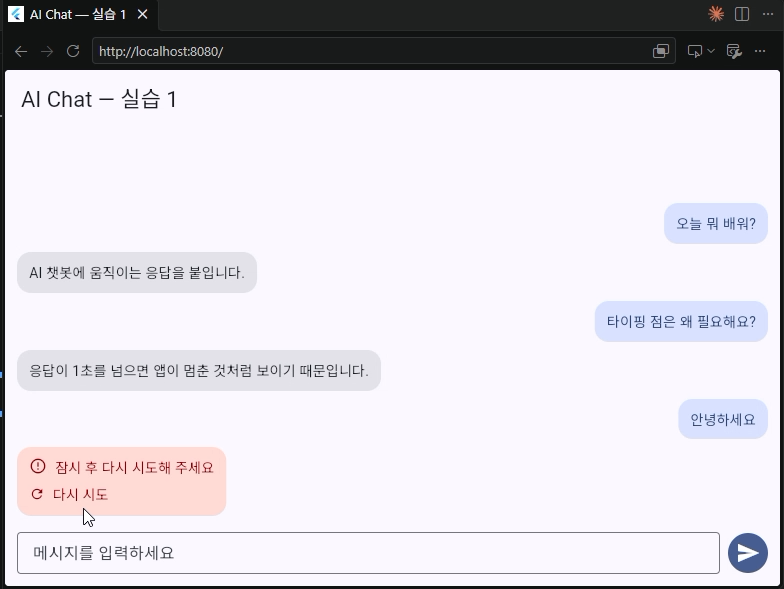
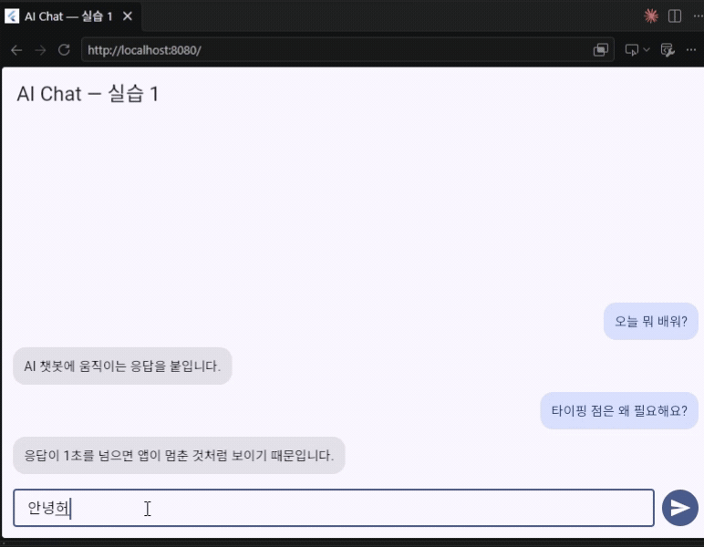

# 실습 1 — 채팅 UI + 오류·재시도 (GAI3008-01 · 11주차)

> 연세대학교 GAI3008-01 응용모바일프로그래밍 11주차 과제 저장소입니다.
> 교수님 스타터 프로젝트(`Baryon Labs · 연세대학교 GAI3008-01 응용모바일프로그래밍 교육자료`)를 기반으로
> **실습 ① TODO 2~5**와 **실습 ④ 오류 및 재시도**를 구현했습니다.

---

## 1. 프로젝트 소개

Flutter로 만든 **채팅 UI 실습 앱**입니다.

- 실습 ①: 말풍선(좌/우), 입력창·전송, 빈 상태, 키보드 대응까지 **UI만** 완성
- 실습 ④: 오류 유형(401/429/500/timeout)별 **오류 말풍선**, **다시 시도**, **`AnimatedSwitcher` 상태 전환**, **429 지수 백오프**

> ⚠️ **실제 AI API를 호출하지 않습니다.**
> 모든 응답은 `lib/main.dart`의 `MockChatReply`가 만드는 **가짜(Mock) 응답**이며,
> API 키·네트워크 요청·외부 패키지는 사용하지 않습니다.

### 구현 범위 요약

| 구분 | 내용 | 상태 |
|---|---|---|
| 실습 ① TODO 2 | 말풍선 2종 — 사용자 오른쪽 / AI 왼쪽 | ✅ 구현 |
| 실습 ① TODO 3 | `TextField` + 전송 버튼, Enter 전송, `dispose` 정리 | ✅ 구현 |
| 실습 ① TODO 4 | 빈 상태 — "무엇이든 물어보세요" (`Stack` 오버레이) | ✅ 구현 |
| 실습 ① TODO 5 | SafeArea + `resizeToAvoidBottomInset` 기본값으로 키보드 회피 | ✅ 구현 |
| 실습 ④ | 401/429/500/timeout 오류 모델과 오류 말풍선 | ✅ 구현 |
| 실습 ④ | "다시 시도" + 로딩 스피너(`AnimatedSwitcher`) | ✅ 구현 |
| 실습 ④ | 429 지수 백오프 (1초 → 2초, 최대 4초) | ✅ 구현 |
| 실제 LLM API 연동 | — | ❌ 미구현 (다음 실습 범위) |

---

## 2. 개발 환경 및 실행 방법

- **Flutter** 3.x (Material 3, `useMaterial3: true`)
- **Dart** 3.x
- 실행 대상: Chrome(웹) / 모바일 에뮬레이터
- 추가 패키지 없음 (`flutter`, `cupertino_icons`만 사용)

```bash
flutter pub get
flutter run -d chrome      # 또는 -d <에뮬레이터>
```

서버가 필요 없습니다. 앱 시작 시 `_defaultMessages`의 **초기 대화 4개**가 표시됩니다.

---

## 3. 실습 ① TODO 2~5 구현 결과

### TODO 2 — 말풍선 2종 (`_Bubble`, `lib/main.dart:408`)

- 사용자: 오른쪽 정렬, `colorScheme.primaryContainer`
- AI: 왼쪽 정렬, `colorScheme.surfaceContainerHighest`
- 최대 너비 `420` 제한, 모서리 반경 14, 테마 색상만 사용 → 다크 모드에서도 안전

### TODO 3 — 입력창과 전송 (`_send`, `lib/main.dart:170`)

- `TextEditingController` + `IconButton.filled(Icons.send)`
- `trim()` 후 빈 문자열이면 **전송하지 않음**
- 전송 시 입력창을 비우고 목록 맨 아래에 사용자 말풍선 추가
- 데스크톱에서 **Enter 키로도 전송** (`onSubmitted`)
- `dispose()`에서 컨트롤러 정리

### TODO 4 — 빈 상태 (`ChatPage`, `lib/main.dart:125`)

- `Expanded > Stack` 위에 `_messages.isEmpty`일 때만 `Center(Text('무엇이든 물어보세요'))` 오버레이
- `ChatPage({initialMessages = _defaultMessages, reply})`로 초기 목록 주입 가능
- `late final _messages = List.of(initialMessages)`로 목록을 복사해 사용

### TODO 5 — 키보드가 입력창을 가리지 않게

- `Scaffold`의 `resizeToAvoidBottomInset` 기본값(true) 유지
- `SafeArea`로 노치·홈 인디케이터 영역 회피
- 위젯 테스트로 작은 화면(320×480)과 키보드 inset 상황을 검증하는 케이스 포함

---

## 4. 실습 ④ 오류 및 재시도 구현 결과

### 오류 모델

- `ChatMessage`에 `error` 필드 추가 → `isError` getter (`lib/main.dart:27`)
- `ChatErrorKind` enum: 상태 코드 + 사용자 안내 문구 보유
- `ChatFailure` 클래스: `ChatErrorKind` + `cause` 보관, `fromStatusCode`/`timeout` 생성자 제공 (`lib/main.dart:67`)
- `typedef ChatReply = Future<String> Function(String text)`로 응답 공급자를 추상화

### Mock 응답

- `MockChatReply` (`lib/main.dart:89`): `failuresBeforeSuccess`만큼 실패 후 성공, 기본 지연 500ms
- 생성자로 실패 종류(`failure`)와 문구 접두사(`replyPrefix`) 지정 가능
- 실제 네트워크 호출은 **없음** (테스트·시연용 가짜 응답)

### 오류 말풍선과 다시 시도

- 실패 시 AI 말풍선 대신 **오류 말풍선** 추가(왼쪽 정렬, `errorContainer` 배경, `Icons.error_outline`)
- 사용자가 보낸 메시지는 그대로 유지
- "다시 시도" 클릭 → 스피너 → 성공 시 오류 말풍선 제거 + AI 응답 추가
- 재시도 실패 시 오류 말풍선은 **중복 추가되지 않고 1개만 유지**
- 요청 중에는 버튼이 사라지고 스피너가 보여 **연타(중복 요청) 방지**

---

## 5. 401, 429, 500, timeout 처리 내용

| 오류 | 발생 상황 | 안내 문구 | 재시도 동작 |
|---|---|---|---|
| **401** `unauthorized` | 인증 실패 / 잘못된 키 | 키/권한을 확인해 주세요 | 즉시 재시도 (백오프 없음) |
| **429** `rateLimited` | 요청 한도 초과 | 잠시 후 다시 시도해 주세요 | **1초 → 2초 지수 백오프** 후 재시도 |
| **500** `server` | 서버 내부 오류 | 응답을 받지 못했습니다 | 즉시 재시도 (백오프 없음) |
| **timeout** | 응답 지연 / 네트워크 문제 | 네트워크를 확인해 주세요 | 즉시 재시도 (백오프 없음) |

- HTTP 상태 코드 → 오류 종류 변환은 `ChatErrorKind.fromStatusCode`가 담당 (401/429 외 코드는 `server`로 처리)
- 알 수 없는 예외는 `server`로, `TimeoutException`은 `timeout`으로 매핑

---

## 6. `AnimatedSwitcher`와 지수 백오프 설명

### `AnimatedSwitcher` (`_Bubble` 내부)

오류 말풍선 안의 액션 영역은 3가지 상태를 가집니다.

| 상태 | Key | 표시 |
|---|---|---|
| 대기 안내 | `ValueKey('backoff')` | 작은 스피너 + **"N초 후 다시 시도"** |
| 요청 중 | `ValueKey('retrying')` | 작은 스피너 |
| 대기 없음 | `ValueKey('retry')` | **"다시 시도"** 버튼 |

- `duration: 200ms`, `easeOut`/`easeIn`으로 상태가 **부드럽게 교체**
- Key가 달라야 `AnimatedSwitcher`가 전환 애니메이션을 수행하므로 상태별 Key를 분리
- 스위처는 **오류 말풍선 내부에만** 존재하며 `Scaffold` 전체에는 영향을 주지 않음

### 429 지수 백오프 (`_backoffDelay`, `lib/main.dart:187`)

- 직전 실패가 **429일 때만** 대기: `1 << _retryAttempt`초 → **1초, 2초, 4초(상한)**
- 401/500/timeout은 `null`을 반환해 **즉시 재시도**
- 대기 중에는 `Future<void>.delayed`로 **비동기 대기** → UI가 멈추지 않음
- 대기 중 "N초 후 다시 시도" 문구로 남은 초를 안내
- 새 메시지를 보내면 재시도 횟수가 **초기화**되어 다시 1초부터 시작
- 모든 `await` 이후 `setState`는 `mounted` 확인 후 호출

---

## 7. 실행 화면 스크린샷 및 GIF

### 채팅 UI (실습 ①)

초기 대화 4개, 좌우로 나뉜 말풍선, 화면 아래 입력창과 전송 버튼입니다.



### 오류 말풍선과 다시 시도 (실습 ④)

429 응답을 받은 뒤 표시되는 오류 말풍선과 "다시 시도" 버튼입니다.



### 429 재시도 데모 (오류 → 재시도 → 성공)

429 오류 → 첫 재시도(1초 대기) → 두 번째 재시도(2초 대기) → Mock 응답 성공까지의 흐름입니다.



> 응답은 실제 API가 아니라 `MockChatReply`가 만드는 **가짜 응답**입니다.
> 시연 영상은 `MockChatReply(failuresBeforeSuccess: 2, failure: ChatFailure(ChatErrorKind.rateLimited))` 설정으로 촬영했고,
> 앱의 기본 설정은 `home: const ChatPage(),`입니다.

---

## 8. 테스트 및 검증 결과

### `dart analyze` — ✅ 통과

```
Analyzing yonsei_gai3008_w11_lab1_chat_ui...
No issues found!
```

### `flutter test` — ⚠️ **환경 오류로 미검증**

- 실행 시 `Connection closed before test suite loaded.` 오류가 발생해 **테스트 통과 여부를 확인하지 못했습니다.**
- 엔진/실행 환경 문제로 판단되어 반복 실행하지 않았으며, **통과했다고 기록하지 않습니다.**

### `test/widget_test.dart`에 작성된 테스트 16개 (통과 여부 미검증)

1. 초기 대화 4개 표시
2. 메시지 전송 시 말풍선 추가
3. 공백만 입력하면 전송되지 않음
4. Enter 키로 전송
5. 작은 화면(320×480)에서 레이아웃 유지
6. 키보드 inset 상황에서 입력창이 화면 안에 유지
7. 오류 말풍선이 왼쪽에 표시됨
8. 오류가 있어도 새 메시지 전송 가능
9. 재시도 성공 시 오류 말풍선이 AI 응답으로 교체
10. 재시도 실패 시 오류 말풍선 재표시
11. 요청 처리 중 중복 전송 방지
12. 재시도 중 스피너 표시 및 버튼 숨김
13. 429는 재시도마다 1초 → 2초 대기 후 성공
14. 401/500/timeout 오류에는 백오프 없음
15. 재시도 대기 중에는 로딩 스피너가 보이고 버튼이 사라짐
16. 오류 유형별 안내 문구 확인

### 수동 검증 — ✅ 완료

- 일반 Chrome에서 **429 → 1초 대기 → 429 → 2초 대기 → Mock 응답 성공** 흐름 확인
- 통과하지 못한 검증: 자동 테스트 전체, 실제 모바일 기기 키보드 동작
- 참고: VS Code 내부 Preview에서만 간헐적으로 흰 화면이 나타났고 일반 Chrome에서는 재현되지 않았습니다. **원인은 확정하지 못했습니다**(환경/렌더러 이슈로 추정).

---

## 9. 단계별 Git 커밋 기록

브랜치: `feat/roy-chat-redo`

| 해시 | 내용 |
|---|---|
| `67c8e0d` | feat: implement chat message bubbles (TODO 2) |
| `7b63949` | feat: add chat input and send button (TODO 3) |
| `4d36c54` | feat: add empty chat state (TODO 4) |
| `3854339` | test: verify keyboard-safe chat layout (TODO 5) |
| `ab7f34a` | feat: implement chat error handling and retry (실습 ④) |

- 시작점: `02bd3db` — 교수님 스타터 (TODO 1 완성, 2~5 TODO)
- 저장소: https://github.com/xide-projext/yonsei_gai3008_w11_lab1_chat_ui
- 커밋 목록(브랜치 Push 후 유효): https://github.com/xide-projext/yonsei_gai3008_w11_lab1_chat_ui/commits/feat/roy-chat-redo

> 개인 fork를 사용하는 경우 위 URL을 **본인 fork 주소**로 바꿔 README에 기재하세요.

---

## 구조

```
lib/main.dart              ← 앱 전체 구현 (모델·Mock·상태·UI)
test/widget_test.dart      ← 위젯 테스트 16개
docs/screenshots/          ← 채팅 UI·오류·재시도 데모 이미지 3개
```

---

## 제출 전 확인 사항

- [x] `docs/screenshots/`에 `chat_ui.png`, `error_retry.png`, `retry_demo.gif` 추가
- [x] README에 이미지 상대 경로로 연결
- [ ] README 미리보기에서 이미지 3개 표시 확인
- [ ] `home: const ChatPage(),` 유지, 임시 Mock 설정 없음 (`git diff` 확인)
- [ ] `flutter pub get` 후 `flutter run -d chrome`으로 재확인
- [ ] `dart analyze` 재실행
- [ ] (가능하면) 다른 환경에서 `flutter test` 재시도 후 결과 갱신
- [ ] 브랜치 Push → 개인 저장소 URL·커밋 목록 URL 최종 확인
- [ ] `analysis_options.yaml`, `pubspec.lock` 변경분은 제출 커밋에 포함하지 않음

---

ⓒ 2026 Baryon Labs · 연세대학교 GAI3008-01 응용모바일프로그래밍 교육자료 (스타터 프로젝트 기반)
